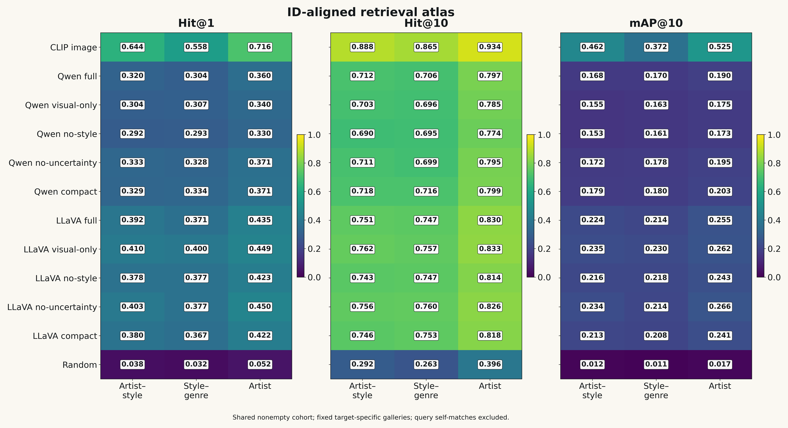

# GALA

### Evaluating Vision-Language Descriptions for Artwork Retrieval


**How much retrieval information survives when an artwork is represented by a generated description?**

GALA compares descriptions produced by Qwen2.5-VL and LLaVA-OneVision with direct CLIP image embeddings on a WikiArt subset. Five prompt variants examine how instructions affect retrieval performance, response length, formatting, and regex-based screening diagnostics.

The repository includes generation code, stored responses, embeddings, experimental logs, an aggregate statistics workbook, and a notebook that regenerates ten scientific figures.

[Quick start](#quick-start) · [Results](#results-at-a-glance) · [Evaluation protocol](#evaluation-protocol) · [Figures](#ten-figures-from-one-workbook) · [Reproducibility](#reproducibility-and-artifact-provenance)



## Start here

| Resource | Contents |
|---|---|
| [Statistics workbook](GALA_statistics.xlsx) | ID-aligned retrieval results, bootstrap summaries, prompt contrasts, diagnostics, and provenance |
| [Plotting notebook](GALA_plot_cell.ipynb) | Self-contained plotting cells using the workbook |
| [Figure collection](GALA_FIGURES/) | Ten figures, each available as PNG and vector PDF |
| [Experiment configuration](configs/art_method.yaml) | Full prompt texts, model paths, generation settings, and encoder configuration |
| [Stored generations](outputs/generations/) | Ten JSONL files containing prompts, responses, image identifiers, and generation settings |
| [Stored embeddings](outputs/embeddings/) | VLM-description, CLIP-image, and historical baseline vectors |
| [Generation logs](logs/) | Archived execution records |

## Quick start

### Regenerate the figures without a GPU

The plotting workflow needs the workbook and standard Python plotting packages. It does not load models, download weights, or require the original images.

```bash
git clone https://github.com/cataug/GALA.git
cd GALA

python3 -m venv .venv
source .venv/bin/activate

python -m pip install --upgrade pip
python -m pip install numpy pandas matplotlib openpyxl jupyterlab

jupyter lab GALA_plot_cell.ipynb
```

Keep `GALA_statistics.xlsx` beside the notebook.

Run the cell beginning:

```python
# GALA v2: boxed numeric annotations and larger fonts.
```

This is the second nonempty code cell. It produces ten PNG files and ten vector PDFs in `GALA_FIGURES/`, overwriting files with the same names.

The v2 cell uses larger fonts and boxed numerical annotations. Its main export settings are:

```python
XLSX = Path("GALA_statistics.xlsx")
OUT = Path("GALA_FIGURES")
DPI = 320
SAVE_PDF = True
```

### Read the main results directly

```python
import pandas as pd

results = pd.read_excel(
    "GALA_statistics.xlsx",
    sheet_name="Retrieval",
)

print(
    results.pivot(
        index="label",
        columns="target",
        values="hit1",
    ).round(3)
)
```

## Experiment at a glance

| Component | Recorded setup |
|---|---|
| Dataset | 5,000 WikiArt images |
| Selection | Sorted-path prefix of the local image collection |
| VLM conditions | Two backbones × five prompts |
| Stored responses | 50,000 |
| Generations per image and condition | One |
| Shared nonempty cohort | 4,678 images |
| Text representation | Whole generated response, prefixed with `query: ` |
| Text encoder | `intfloat/e5-small-v2`, 384 dimensions |
| Image baseline | OpenCLIP `ViT-B-32`, `laion2b_s34b_b79k`, 512 dimensions |
| Ranking | Cosine similarity with the query image excluded |
| Generation | Greedy decoding, `do_sample=False`, `max_new_tokens=220` |
| Configured seed | 42 |

The archived image subset is not a balanced random sample. Later manifests with “balanced” in their filenames describe a different selection procedure and should not be substituted when interpreting the stored generations.

### Vision-language models

| Configuration key | Hugging Face checkpoint |
|---|---|
| `qwen25vl_3b` | [`Qwen/Qwen2.5-VL-3B-Instruct`](https://huggingface.co/Qwen/Qwen2.5-VL-3B-Instruct) |
| `llava_onevision_0_5b` | [`llava-hf/llava-onevision-qwen2-0.5b-ov-hf`](https://huggingface.co/llava-hf/llava-onevision-qwen2-0.5b-ov-hf) |

These identify the checkpoint families. Exact downloaded weight revisions were not recorded in the archived experiment.

### Prompt variants

| Variant | Requested response |
|---|---|
| `full` | Visible content, composition, color and texture, style cues, and uncertain hypotheses |
| `visual_only` | Visible content, composition, and color and texture; restricts contextual attribution |
| `no_style` | Visible description without naming styles, periods, artists, schools, museums, or exact dates |
| `no_uncertainty` | Description with style cues, without a separate uncertain-hypotheses section |
| `compact` | A compact description in three sentences |

The complete prompts are provided under `ablations` in [`configs/art_method.yaml`](configs/art_method.yaml).

Headings are instructions to the models. The executed embedding workflow uses the complete response and does not parse these headings into structured fields.

## Results at a glance

Selected **Hit@1** results from the workbook’s `Retrieval` sheet:

| Representation | Artist–style | Style–genre | Artist |
|---|---:|---:|---:|
| **CLIP image** | **0.644** | **0.558** | **0.716** |
| LLaVA visual-only | 0.410 | 0.400 | 0.449 |
| LLaVA no-uncertainty | 0.403 | 0.377 | 0.450 |
| Qwen no-uncertainty | 0.333 | 0.328 | 0.371 |
| Qwen compact | 0.329 | 0.334 | 0.371 |
| Random | 0.038 | 0.032 | 0.052 |

All ten VLM conditions are included in the workbook.

CLIP provides the strongest retrieval representation under the evaluated relevance definitions. Generated descriptions preserve useful retrieval information, while the strongest prompt depends on the backbone, target, and metric.

These results describe the stored model outputs and evaluated cohorts. Small differences between individual prompts should be assessed using the accompanying paired intervals.

## Evaluation protocol

The evaluated task is **artwork-to-artwork retrieval**. Each query artwork retrieves other artworks represented by descriptions or image embeddings.

1. **Generate descriptions.** Supply an artwork image and one prompt variant to a VLM.
2. **Retain the raw response.** Store its image identifier, prompt, decoding settings, and generated text.
3. **Embed the response.** Encode `query: ` followed by the whole nonempty response with E5.
4. **Attach catalogue labels by identity.** Recover the image-to-metadata relationship through stored identifiers and image basenames.
5. **Rank and evaluate.** Rank gallery items by cosine similarity, exclude the query itself, and evaluate catalogue-label matches.

Catalogue labels determine retrieval relevance. They are not supplied as artwork attributes to the VLM.

### Retrieval targets

| Target | Relevance condition | Eligible images | Classes |
|---|---|---:|---:|
| Artist–style | Same artist and style | 4,674 | 67 |
| Style–genre | Same style and genre | 4,657 | 100 |
| Artist | Same artist | 4,678 | 24 |

Each target starts from the common nonempty cohort. Singleton classes are excluded because they have no relevant gallery item after self-exclusion.

### Metrics

| Metric | Interpretation |
|---|---|
| Hit@1, Hit@5, Hit@10 | Fraction of queries with at least one relevant item within the first K results |
| mAP@10 | Mean average precision over the first ten results |
| Retrieval-depth profile | Hit rate at each integer K from 1 to 50 |
| Response length | Whitespace-separated word count |
| Heading compliance | Presence of all headings requested by a prompt |
| Empty-output rate | Fraction of stored responses without usable text |

Historical CSV files use `recall@K` for the hit-rate definition above. The workbook uses `hit1`, `hit5`, and `hit10`.

For AP@10, precision at each relevant rank is summed over ranks 1–10 and divided by `min(10, number of relevant gallery items)`. mAP@10 averages this value across eligible queries.

The workbook includes 2,000-replicate paired query and artist-cluster bootstrap summaries. These intervals condition on the stored outputs and fixed gallery; they do not estimate generation-to-generation variation.

## Interpreting the screening diagnostic

The historical function `hallucination_proxy` in [`src/art_common.py`](src/art_common.py) applies 13 case-insensitive regular expressions to generated text. Patterns include attribution phrases, four-digit years, century references, and mentions of museums or titles.

Its per-response score is:

```text
regex density = number of regex matches / max(1, number of nonempty sentence segments)
```

Sentence segments are separated using `[.!?;\n]+`. Patterns can overlap, so the density can exceed 1.

This is a surface-form screening diagnostic. It does not extract atomic claims, inspect image evidence, establish metadata support, or distinguish true statements from false statements. Explicit uncertainty does not trigger a separate factuality judgement.

The historical implementation assigns zero to empty responses. Empty-output counts therefore need to be read alongside the screening score.

Direct metadata-attribute accuracy and human-verified hallucination rates are not measured in this release.

## Ten figures from one workbook

The notebook exports every figure as PNG and vector PDF.

| Figure | What it shows | Files |
|---|---|---|
| 01 · Retrieval atlas | Hit@1, Hit@10, and mAP@10 across systems and targets | [PNG](GALA_FIGURES/01_retrieval_atlas.png) · [PDF](GALA_FIGURES/01_retrieval_atlas.pdf) |
| 02 · Matched prompt comparisons | Backbone differences under the same prompt | [PNG](GALA_FIGURES/02_matched_prompt_dumbbells.png) · [PDF](GALA_FIGURES/02_matched_prompt_dumbbells.pdf) |
| 03 · Retrieval–proxy frontier | Retrieval, regex density, and response length | [PNG](GALA_FIGURES/03_retrieval_proxy_frontier.png) · [PDF](GALA_FIGURES/03_retrieval_proxy_frontier.pdf) |
| 04 · Hybrid paths | Retrieval as the CLIP mixture weight changes | [PNG](GALA_FIGURES/04_hybrid_paths.png) · [PDF](GALA_FIGURES/04_hybrid_paths.pdf) |
| 05 · Description lengths | Word-count distributions across conditions | [PNG](GALA_FIGURES/05_word_length_ridgelines.png) · [PDF](GALA_FIGURES/05_word_length_ridgelines.pdf) |
| 06 · Regex fingerprint | Contributions of individual screening patterns | [PNG](GALA_FIGURES/06_regex_fingerprint.png) · [PDF](GALA_FIGURES/06_regex_fingerprint.pdf) |
| 07 · Identity-join audit | Effect of repairing image-to-label attachment | [PNG](GALA_FIGURES/07_qwen_identity_audit.png) · [PDF](GALA_FIGURES/07_qwen_identity_audit.pdf) |
| 08 · Artist heterogeneity | Variation across artist classes | [PNG](GALA_FIGURES/08_artist_heterogeneity.png) · [PDF](GALA_FIGURES/08_artist_heterogeneity.pdf) |
| 09 · Paired prompt contrasts | Changes from the full prompt with paired intervals | [PNG](GALA_FIGURES/09_paired_prompt_contrasts.png) · [PDF](GALA_FIGURES/09_paired_prompt_contrasts.pdf) |
| 10 · Retrieval-depth profiles | Hit-rate curves from K=1 to K=50 | [PNG](GALA_FIGURES/10_retrieval_depth_profiles.png) · [PDF](GALA_FIGURES/10_retrieval_depth_profiles.pdf) |

Hybrid weights were inspected on the evaluation cohort. The resulting curves are descriptive and do not establish an independently validated improvement over CLIP.

## Reproducibility and artifact provenance

### Which results should I use?

Use the workbook’s **`Retrieval`** sheet for the ID-aligned common-cohort comparison presented above.

The workbook also retains historical exports in `Archived`, `ArchivedCI`, and `ArchivedHybrid`. These preserve earlier calculations and may use different row attachments or cohorts.

The plotting notebook renders the supplied aggregate statistics. It does not rebuild the workbook from raw generations or recompute bootstrap samples.

### Why was identity alignment necessary?

Some Qwen responses were empty and were removed before text embedding. An archived evaluation path then attached metadata by row position instead of the stored image identity.

This shifted labels relative to embeddings and produced misleading near-random results for several Qwen conditions.

The reanalysis restores the identity relationship while retaining the stored vectors. The `JoinRepair` sheet compares positional and identity-based attachment on identical embedding rows.

The historical `evaluate_fixed_retrieval.py` still contains a positional fallback: its NPZ wrapper uses `__emb_id__`, which is absent from the recognized identifier list. Running that evaluator unchanged is therefore not a reproduction of the workbook’s identity-aligned analysis.

### Historical baseline and metric fields

| Artifact | Meaning in the archived experiment |
|---|---|
| Metadata-text baseline | Encodes the constant string `artwork style or category: images`; it is excluded from the main retrieval comparison |
| `lexical_label_alignment` | Measures lexical overlap with the generation label `images`; it does not measure artist, style, or genre accuracy |
| `hallucination_proxy_rate` | Historical field name for regex-match density |
| `Diagnostics.duplicate_extra_count` | Historical exact-response duplicate count; whitespace-only responses can contribute |

These fields remain available for provenance. They should be interpreted according to their implemented definitions.

### Coverage and unknown labels

Qwen has 320 empty responses under `full`, 89 under `visual_only`, and 41 under `no_uncertainty`. The other two Qwen conditions and all five LLaVA conditions have no empty responses.

The common-cohort retrieval analysis excludes images missing a nonempty response in any condition. Its model comparisons are therefore conditional on successful output coverage.

The workbook retains the source Unknown Artist and Unknown Genre codes as relevance labels. In style–genre retrieval, Unknown Genre is paired with each style, producing separate composite classes. It is not one pooled genre-independent class.

### Source snapshot

The workbook records the experimental source snapshot:

```text
fd7293cca70e12119c9df6106d3dafe7afe0dc3f
```

The `Provenance` sheet contains source paths, SHA-256 hashes, sizes, and repository URLs. The `Experiment` sheet records methodological settings and interpretation notes.

## Running new generation experiments

New inference requires local WikiArt images, model weights, and an appropriate PyTorch environment. A CUDA-capable GPU is recommended.

### 1. Install inference dependencies

After installing a suitable PyTorch build for your hardware:

```bash
python -m pip install -r requirements.txt
python -m pip install \
  pyyaml sentence-transformers open_clip_torch \
  scikit-learn matplotlib openpyxl
```

The historical dependency list includes an unpinned Transformers Git dependency. Preserve the resolved package versions when creating a new experimental environment.

### 2. Download the evaluated model families

```bash
python scripts/download_models.py
```

The downloader writes weights to the local `models/` directory.

### 3. Configure local paths

Update [`configs/art_method.yaml`](configs/art_method.yaml):

| Setting | Point it to |
|---|---|
| `paths.project_dir` | Your GALA checkout |
| `paths.wikiart_dir` | Your local WikiArt image directory |
| `paths.models_dir` | Downloaded model directory |
| `paths.outputs_dir` | A separate directory for the new run |
| `paths.runs_dir` | Your run directory |
| `models.*.local_dir` | The corresponding local checkpoint directory |

The archived configuration and several shell wrappers contain machine-specific `/home/tahiti/...` paths. Use the Python entry points after adapting the configuration.

### 4. Prepare a manifest

A generation manifest must contain `image_id` and `image_path`. Use stable, unique identifiers and valid local image paths.

For retrieval evaluation, preserve the corresponding catalogue attributes and their relationship to each image. A folder name such as `images` is not a meaningful artist, style, or genre label.

The repository includes metadata-oriented manifest builders:

- [`src/build_wikiart_manifest_from_metadata.py`](src/build_wikiart_manifest_from_metadata.py)
- [`src/build_manifest_for_existing_generations.py`](src/build_manifest_for_existing_generations.py)

Review their path assumptions and selection procedures before using them for a new dataset.

### 5. Test a small generation run

```bash
python src/generate_vlm.py \
  --config configs/art_method.yaml \
  --manifest /absolute/path/to/manifest.csv \
  --model-key qwen25vl_3b \
  --ablation full \
  --limit 20 \
  --batch-size 1
```

Change `--model-key` and `--ablation` to select another condition. Batch sizes can subsequently increase according to the adaptive batching configuration.

Use a separate output directory for small tests and full runs.

### 6. Embed stored responses

```bash
python src/embed_generations.py \
  --config configs/art_method.yaml \
  --input-jsonl /absolute/path/to/run/generations/qwen25vl_3b__full.jsonl \
  --out /absolute/path/to/run/embeddings/qwen25vl_3b__full.npz
```

This embeds whole nonempty responses and stores their image identifiers. Preserve those identifiers when attaching evaluation labels.

## Repository map

| Location | Purpose |
|---|---|
| `configs/` | Prompts and experiment settings |
| `src/generate_vlm.py` | VLM inference and JSONL output |
| `src/embed_generations.py` | Whole-response E5 embeddings |
| `src/build_baselines.py` | CLIP, random, and historical metadata-text embeddings |
| `src/art_common.py` | Shared utilities and regex-screening implementation |
| `src/evaluate.py` | Original evaluation workflow |
| `src/evaluate_fixed_retrieval.py` | Historical metadata-based evaluator |
| `outputs/` | Archived manifests, responses, vectors, and result exports |
| `logs/` | Archived execution logs |
| `GALA_statistics.xlsx` | Aggregate reanalysis and provenance |
| `GALA_plot_cell.ipynb` | Workbook-based plotting |
| `GALA_FIGURES/` | Ten statistical figures |

## Scope and limitations

The experiment evaluates retrieval utility and observable output characteristics on one stored WikiArt subset.

Catalogue-label equality is a coarse relevance signal. The subset is imbalanced, unknown-label codes are retained in the primary workbook, and the common-cohort analysis conditions on nonempty outputs.

Each image has one generation per condition. Bootstrap intervals describe uncertainty over the evaluated queries or artist clusters with fixed outputs and gallery.

The screening diagnostic has no expert factuality validation. Generated descriptions require independent verification before being used as authoritative collection metadata.

## Citation

If this repository supports your work, cite the companion study and identify the repository revision used:

```bibtex
@misc{gala2026,
  title  = {{GALA}: Evaluating Vision-Language Descriptions
            for Artwork Retrieval},
  author = {Tynchenko, Vadim S. and
            Gantimurov, Andrei P. and
            Nelyub, Vladimir A. and
            Borodulin, Aleksei S. and
            Malashin, Ivan P.},
  year   = {2026},
  url    = {https://github.com/cataug/GALA},
  note   = {Companion code and experimental artifacts}
}
```

## Data, models, and licensing

Raw WikiArt images and model weights are not distributed in this repository. Obtain them from their original providers and follow their respective terms.

The current repository snapshot does not include a repository-level software license.
